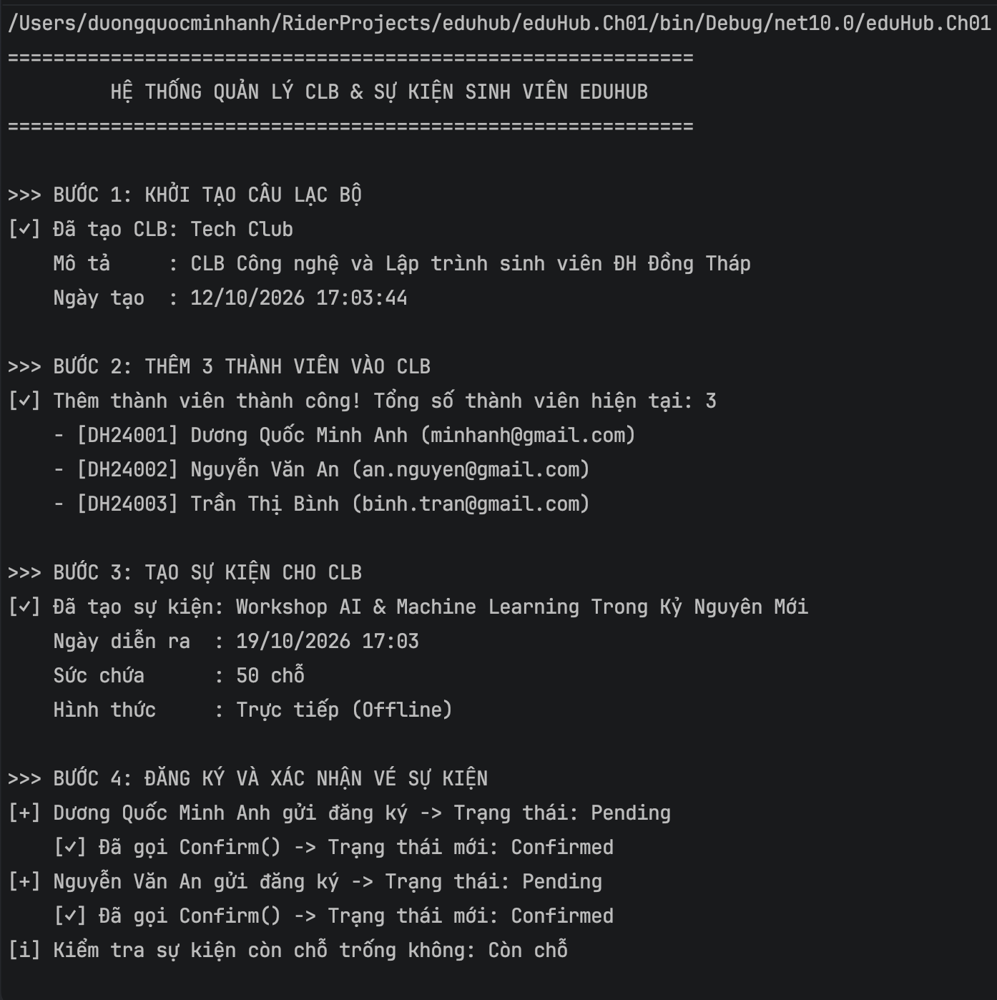
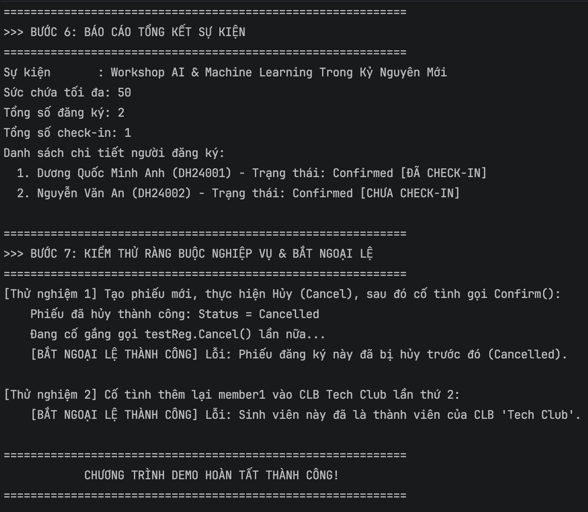

# EduHub - Hệ Thống Quản Lý Câu Lạc Bộ & Sự Kiện (Chương 01)

## 1. Giới thiệu dự án
Dự án mô phỏng phân hệ quản lý hoạt động câu lạc bộ, đăng ký sự kiện và điểm danh sinh viên (EduHub) thuộc môn **Kiến trúc và Thiết kế Phần mềm**. Dự án tập trung vào việc áp dụng các nguyên lý lập trình hướng đối tượng (OOP), tính đóng gói nghiêm ngặt (Encapsulation) và thiết kế miền nghiệp vụ (Domain Model).

## 2. Các thực thể cốt lõi (Domain Entities)
Hệ thống bao gồm 5 thực thể chính trong thư mục `Domain/`:
- **`Member`**: Quản lý thông tin sinh viên, trạng thái hoạt động (`IsActive`), kích hoạt/vô hiệu hóa tài khoản.
- **`Club`**: Quản lý thông tin câu lạc bộ, danh sách thành viên (`IReadOnlyCollection<Member>`) và số lượng thành viên.
- **`Event`**: Quản lý sự kiện, thời gian diễn ra, trạng thái mở/đóng đăng ký, số lượng đăng ký tối đa (`MaxRegistrations`).
- **`Registration`**: Quản lý phiếu đăng ký tham gia sự kiện của thành viên, kiểm soát trạng thái theo Enum `RegistrationStatus` (`Confirmed`, `Cancelled`).
- **`CheckIn`**: Bản ghi điểm danh sự kiện, hỗ trợ hình thức điểm danh theo Enum `CheckInMethod` (`QrCode`, `Manual`).

### Điểm nổi bật về kỹ thuật:
- **Encapsulation & Private Constructor:** Toàn bộ thực thể ẩn constructor mặc định, bắt buộc khởi tạo qua **Static Factory Method** (`Create(...)`).
- **Data Validation & Business Rules:** Kiểm tra tính hợp lệ dữ liệu ngay tại phương thức tạo; ném `ArgumentException` hoặc `InvalidOperationException` khi vi phạm nghiệp vụ (hủy vé đã hủy, điểm danh sự kiện đã đóng, đăng ký vượt giới hạn...).
- **Immutability:** Các tập hợp (Collection) được bảo vệ bằng `IReadOnlyCollection` để chống thêm/sửa trực tiếp từ bên ngoài.

## 3. Cấu trúc thư mục
```text
eduHub/
├── eduHub.Ch01/
│   ├── docs/
│   │   ├── images/              # Ảnh chụp màn hình chạy demo
│   │   ├── class-diagram.md     # Sơ đồ lớp Mermaid (Domain Class Diagram)
│   │   └── user-stories.md      # Danh sách User Stories nghiệp vụ
│   ├── Domain/                  # 5 Domain Entities & Enums
│   ├── Program.cs               # Kịch bản Console Demo 7 bước
│   └── README.md                # Tài liệu dự án
└── eduhub.sln
```

## 4. Hướng dẫn chạy ứng dụng

### Yêu cầu tiên quyết
- Cài đặt [.NET 10.0 SDK](https://dotnet.microsoft.com/download) trở lên.
- Kiểm tra cài đặt thành công:
  ```bash
  dotnet --version
  ```

### Cách 1: Sử dụng dòng lệnh (.NET CLI)
- **Chạy từ thư mục gốc giải pháp (`eduhub/`):**
  ```bash
  dotnet run --project eduHub.Ch01
  ```
- **Hoặc chuyển vào thư mục dự án:**
  ```bash
  cd eduHub.Ch01
  dotnet run
  ```
- *(Tùy chọn) Biên dịch dự án trước khi chạy:*
  ```bash
  dotnet build
  ```

### Cách 2: Sử dụng IDE (JetBrains Rider, Visual Studio, VS Code)
- **JetBrains Rider / Visual Studio:**
  1. Mở file giải pháp [eduhub.sln](file:///Users/duongquocminhanh/RiderProjects/eduhub/eduhub.sln).
  2. Chọn project khởi chạy là `eduHub.Ch01`.
  3. Nhấn biểu tượng **Run** (hoặc bấm `Ctrl + F5` / `F5`).
- **Visual Studio Code:**
  1. Mở thư mục dự án trong VS Code.
  2. Mở Terminal tích hợp và chạy lệnh:
     ```bash
     dotnet run --project eduHub.Ch01
     ```

## 5. Kết quả chạy thử nghiệm (Console Demo)

Chương trình console mô phỏng đầy đủ kịch bản 7 bước bao gồm: khởi tạo CLB, thêm thành viên, tạo sự kiện, đăng ký vé, điểm danh, báo cáo tổng kết và kiểm thử các ràng buộc nghiệp vụ (bắt ngoại lệ).

### Phần 1: Khởi tạo CLB, thành viên, sự kiện và đăng ký vé (Bước 1 - Bước 4)


### Phần 2: Báo cáo tổng kết và kiểm thử ràng buộc nghiệp vụ & bắt ngoại lệ (Bước 6 - Bước 7)


